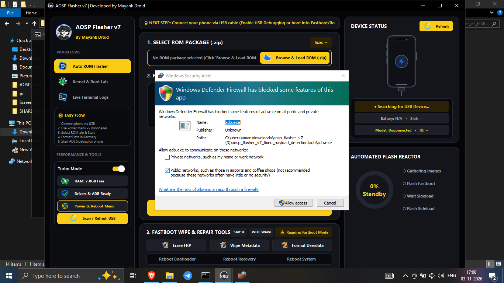
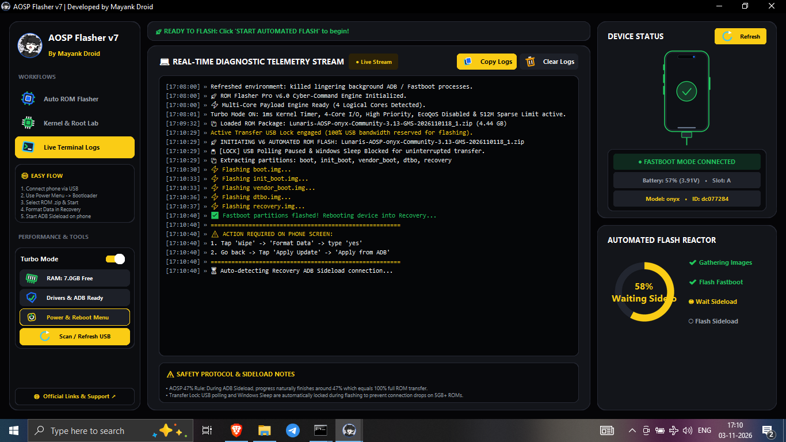
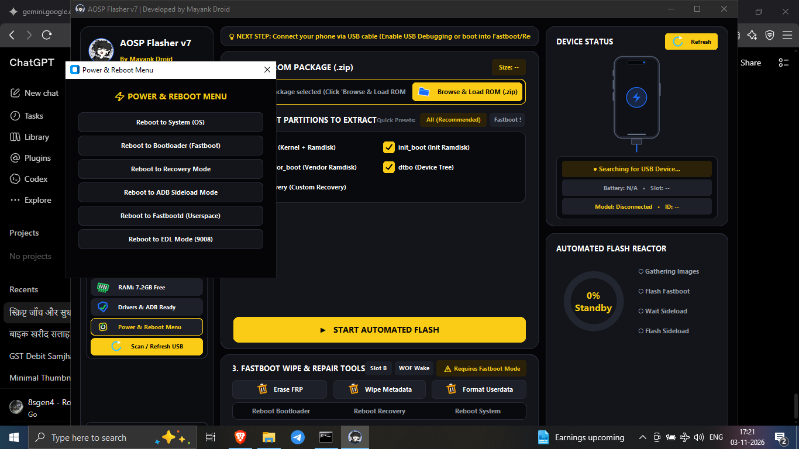
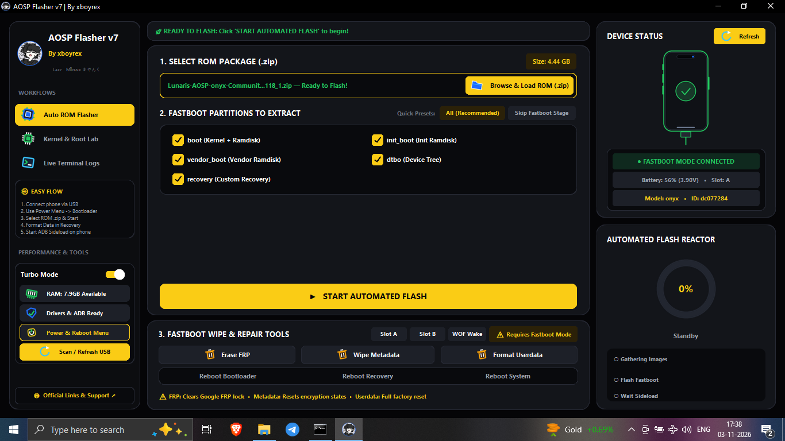
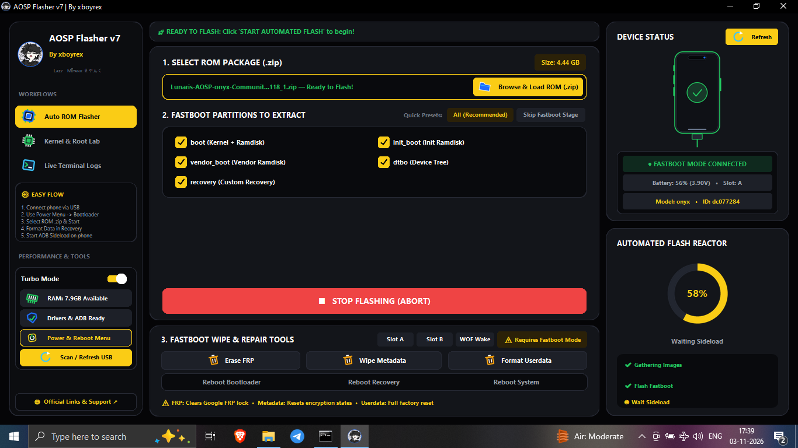
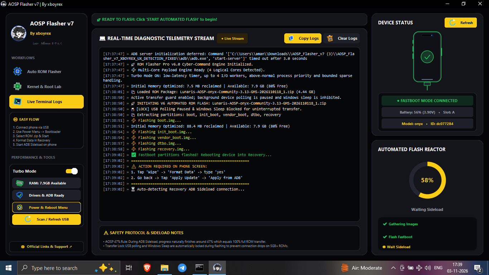
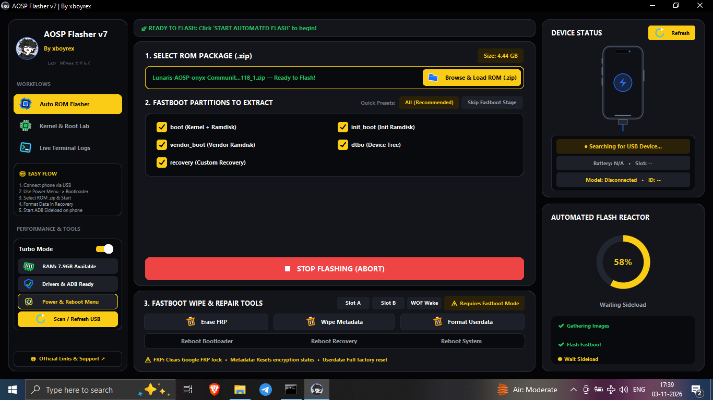
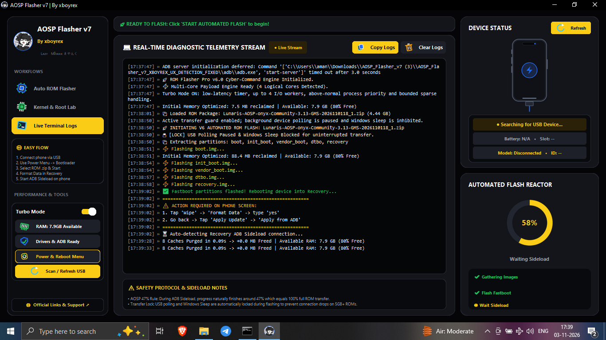

### Windows Android / AOSP flashing and device-maintenance utility

**By xboyrex**
**ㅤᏞᴀᴢʏㅤᎷꫝʏᴀɴк まやんく**

[Download latest release](https://github.com/xboyrex/AOSP-Flasher-v7/releases) · [Report an issue](https://github.com/xboyrex/AOSP-Flasher-v7/issues)

---

## Application gallery

The following gallery contains all eight supplied application screenshots. Open any image to view it at full resolution.

<table>
<tr>
<td width="50%" align="center">

<strong>Interface · 01</strong>
</td>
<td width="50%" align="center">

<strong>Interface · 02</strong>
</td>
</tr>
<tr>
<td width="50%" align="center">

<strong>Interface · 03</strong>
</td>
<td width="50%" align="center">

<strong>Interface · 04</strong>
</td>
</tr>
<tr>
<td width="50%" align="center">

<strong>Interface · 05</strong>
</td>
<td width="50%" align="center">

<strong>Interface · 06</strong>
</td>
</tr>
<tr>
<td width="50%" align="center">

<strong>Interface · 07</strong>
</td>
<td width="50%" align="center">

<strong>Interface · 08</strong>
</td>
</tr>
</table>

---

## Overview

AOSP Flasher v7 is a Windows desktop utility for selected Android device-maintenance and ROM-flashing workflows. It combines ROM package selection, partition-image extraction, ADB/Fastboot device status, flashing progress, recovery hand-off guidance, and diagnostic logs in one desktop interface.

The application is intended for users who understand Android bootloader states, partition layouts, recovery environments, and firmware compatibility.

## Core capabilities

### ROM package and partition workflow

The interface provides ROM ZIP selection and selectable extraction targets:

| Image | Typical role |
|---|---|
| `boot.img` | Kernel and boot ramdisk |
| `init_boot.img` | Initial ramdisk on supported Android devices |
| `vendor_boot.img` | Vendor boot image and vendor ramdisk |
| `dtbo.img` | Device Tree Blob Overlay |
| `recovery.img` | Recovery image, when supplied and supported |

The images available depend on the selected ROM package and device. A selectable option does not guarantee that the package contains that image.

### Device detection and connection

- USB device refresh and status display.
- ADB and Fastboot mode detection.
- Device model and identifier when reported by the device.
- Battery and active-slot details when exposed by the device and current mode.
- Recovery ADB sideload hand-off and connection monitoring.
- Diagnostic logging for connection and flashing stages.

### Flashing and recovery workflow

- Automated Fastboot flashing for selected partition images.
- Stage and progress indicators.
- Reboot / hand-off to recovery after the Fastboot stage.
- Recovery-side instructions for the user.
- Live log view with copy and clear actions.

### Device controls

Available actions depend on device mode, bootloader state, permissions, and manufacturer support:

- Reboot to System.
- Reboot to Bootloader / Fastboot.
- Reboot to Recovery.
- Reboot to ADB Sideload.
- Reboot to Fastbootd (userspace).
- EDL mode (9008) option on compatible configurations.
- Slot A / Slot B selection.
- Wipe Metadata and Format Userdata controls.
- FRP-related control, only for legitimate, authorized servicing.

## Payload extraction and ROM compatibility

Android ROM ZIP formats are not interchangeable. Packages may contain `payload.bin`, standalone partition images, or recovery-specific installers. Extraction support depends on the archive structure and the tools bundled with or available to the application.

Do not assume every ROM ZIP can be flashed directly through Fastboot. If extraction reports an unsupported payload, missing image, checksum error, or malformed archive, stop and verify the package. Never flash a partially extracted image set.

## Requirements

- Windows 10 or Windows 11, 64-bit.
- A compatible USB data cable and working USB port.
- Device-specific USB drivers where required.
- Android Platform Tools (`adb` and `fastboot`) available to the application.
- USB debugging enabled for ADB operations, or the device booted into the required Fastboot / Recovery mode.
- Correct device-specific ROM package and adequate battery charge.

## Getting started

1. Install the required USB drivers and Android Platform Tools.
2. Back up important data before any maintenance or flashing operation.
3. Connect the device in the required ADB or Fastboot mode.
4. Use the device refresh control and verify the detected model and mode.
5. Select the correct ROM ZIP and inspect the available partition images.
6. Confirm device codename, image compatibility, and selected partitions.
7. Follow every recovery-side instruction displayed by the application.
8. If a stage fails, preserve the diagnostic logs and investigate before retrying.

## Troubleshooting

| Problem | Recommended checks |
|---|---|
| Device not detected | Check cable, USB port, drivers, USB debugging, and current device mode. |
| ADB works but Fastboot does not | Reboot to bootloader and verify with `fastboot devices`. |
| Recovery sideload is not detected | In recovery, select **Apply Update / ADB Sideload**, then refresh detection. |
| Payload extraction fails | Inspect the ZIP structure and confirm that its payload format is supported. |
| Partition image is missing | Confirm the ROM actually contains that image; do not substitute another device's image. |
| Flash command fails | Stop, save logs, and verify device codename, partition compatibility, and bootloader state. |
| Device enters an unexpected mode | Read the device screen and do not issue further commands until its state is understood. |

## Downloads

Get the Windows executable, source ZIP, and build script from the official [GitHub Releases](https://github.com/xboyrex/AOSP-Flasher-v7/releases) page.

## Safety and disclaimer

Firmware flashing, metadata wiping, userdata formatting, slot changes, and low-level device operations can permanently erase data or leave a device unbootable when performed incorrectly.

You are responsible for verifying the exact device model and codename, ROM integrity, partition compatibility, bootloader state, and recovery procedure. Maintain a verified backup before proceeding. No universal device compatibility or data-recovery guarantee is provided.

This is an independent utility and is not affiliated with or endorsed by Google, AOSP, Android, or any device manufacturer. Do not use it to bypass ownership protections, access controls, or anti-theft security on devices you do not own or are not authorized to service.

---

**AOSP FLASHER v7**
Windows Android / AOSP device utility

**By xboyrex**
**ㅤᏞᴀᴢʏㅤᎷꫝʏᴀɴк まやんく**

