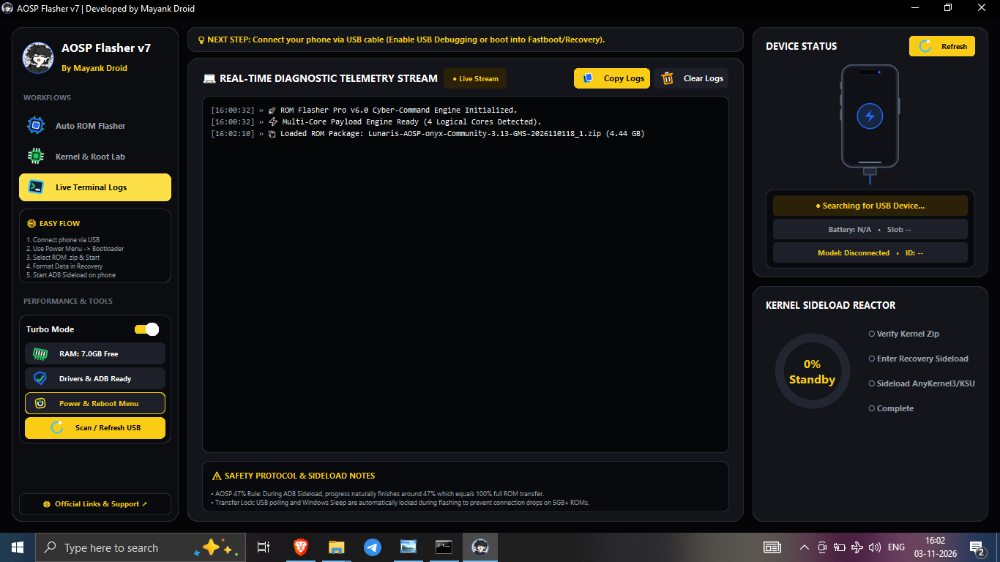

# AOSP Flasher v7

**Windows Android / AOSP flashing utility**

**By xboyrex**
**ㅤᏞᴀᴢʏㅤᎷꫝʏᴀɴк まやんく**

---

## Application Preview

  
  
AOSP Flasher v7 — application interface and flashing workflow.

## Overview

AOSP Flasher v7 is a Windows desktop utility for selected Android device maintenance and ROM-flashing workflows. It brings ROM package selection, partition extraction, ADB/Fastboot device status, flashing progress, and recovery hand-off guidance into one desktop interface.

The application is intended for users familiar with Android bootloader states, partition layouts, recovery environments, and firmware flashing risks.

## Core Capabilities

### ROM package and partition workflow

The interface provides ROM ZIP selection and selectable extraction targets:

| Image | Purpose |
|---|---|
| `boot.img` | Kernel and boot ramdisk |
| `init_boot.img` | Initial ramdisk on supported devices |
| `vendor_boot.img` | Vendor boot image |
| `dtbo.img` | Device Tree Blob Overlay |
| `recovery.img` | Recovery image where supplied and supported |

Actual image availability depends on the ROM package and device. A selectable option does not mean every package contains that image.

### Device detection

- USB device status with refresh action.
- ADB and Fastboot connection workflow.
- Device model and identifier when reported by the connected device.
- Battery and slot information when exposed by the device and current mode.
- Recovery ADB sideload hand-off and connection monitoring.

### Flashing workflow

- Automated Fastboot flashing for selected images.
- Flash progress and stage indicators.
- Recovery transition after the Fastboot stage.
- On-screen recovery-side instructions.
- Live diagnostic log view with copy and clear controls.

### Device maintenance actions

Depending on device mode, bootloader state, permissions, and device support, the interface exposes:

- Reboot to System.
- Reboot to Bootloader / Fastboot.
- Reboot to Recovery.
- Reboot to ADB Sideload.
- Reboot to Fastbootd (userspace).
- EDL mode (9008) reboot option for compatible devices/configurations.
- Slot A / Slot B selection.
- Wipe Metadata and Format Userdata controls.
- FRP-related control, subject to legitimate authorization and device support.

## Payload and ROM Compatibility

ROM ZIP formats differ. A package may contain `payload.bin`, standalone partition images, or a recovery-specific installer. Extraction support depends on the actual package structure and available tools.

Do not assume every ZIP can be flashed directly through Fastboot. If extraction reports a missing image, unsupported payload format, checksum error, or malformed archive, stop and verify the package. Never flash a partially extracted image set.

## Requirements

- Windows 10 or Windows 11, 64-bit.
- Compatible USB data cable and USB port.
- Device-specific USB drivers where required.
- Android Platform Tools (`adb` and `fastboot`) available to the application.
- USB debugging enabled for ADB operations, or the device booted into the required Fastboot / Recovery mode.
- Correct device-specific ROM package and sufficient battery.

## Download

Download the Windows executable and source package from **[GitHub Releases](https://github.com/xboyrex/AOSP-Flasher-v7/releases)**.

## Basic Workflow

1. Install required USB drivers and Android Platform Tools.
2. Back up important user data.
3. Connect the device in the required ADB or Fastboot mode.
4. Refresh device status and verify the detected model and mode.
5. Select the correct ROM ZIP and review available partition images.
6. Confirm device compatibility and selected partitions.
7. Follow all recovery-side instructions shown by the application.
8. Review diagnostic logs if a stage fails. Do not blindly repeat a failed flash.

## Troubleshooting

| Symptom | Checks |
|---|---|
| Device not detected | Check cable, USB port, drivers, USB debugging, and device mode. |
| ADB detected but Fastboot is not | Reboot to bootloader and verify `fastboot devices`. |
| Recovery sideload not detected | Enter recovery's **Apply Update / ADB Sideload** mode, then refresh detection. |
| Partition image missing | Inspect ZIP structure; it may use `payload.bin` or another installer format. |
| Flash command fails | Stop, preserve logs, and verify device codename and partition compatibility. |
| Device enters an unexpected mode | Check the device screen before issuing further commands. |

## Safety Disclaimer

Firmware flashing, metadata wiping, userdata formatting, slot changes, and low-level device operations can permanently erase data or render a device unbootable if used incorrectly.

You are responsible for verifying the exact device model/codename, ROM integrity, partition compatibility, bootloader state, and recovery procedure. Maintain a verified backup before proceeding. No universal compatibility or data-recovery guarantee is provided.

This is an independent utility and is not affiliated with or endorsed by Google, AOSP, Android, or any device manufacturer. Do not use it to bypass ownership protections, access controls, or anti-theft security on devices you do not own or are not authorized to service.

## Credits

**Developer:** xboyrex
**Branding:** ㅤᏞᴀᴢʏㅤᎷꫝʏᴀɴк まやんく

---

**AOSP FLASHER v7**
Built for careful, device-specific Android maintenance.

